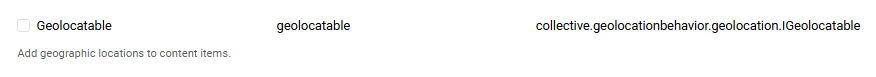
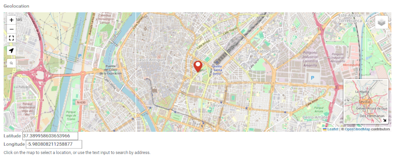

==============================
collective.geolocationbehavior
==============================

This package provides a Dexterity based behaviors for
`Geotagging <https://en.wikipedia.org/wiki/Geotagging>`_.

Features
========

- Implements the `plone.formwidget.geolocation <https://github.com/collective/plone.formwidget.geolocation>`_ add-on which adds `LeafletJS <https://leafletjs.com/>`_ support.
- Adds catalog indexes/metadata for latitude/longitude to support GeoJSON feature list output/filtering.
- The GeoJSON properties can be customized with the provided ``IGeoJSONProperties`` adapter.

Screenshots
===========

After installation, you will find a new behavior available, go to ``Site Setup`` > ``Content Types`` there select a content type and
click on the ``Behaviors`` tab, there you can see the new behavior called ``geolocatable`` as the following screenshot:

   The ``IGeolocatable`` Behavior.

----

   Using the ``IGeolocatable`` Behavior into a custom content type.

Examples
========

This add-on can be seen in action at the following add-ons:

- https://github.com/collective/collective.collectionfilter
- https://github.com/collective/collective.contentsections
- https://github.com/collective/collective.venue

Translations
============

This product has been translated into:

- German
- France
- Italian
- Spanish

Compatibility
=============

Version 3.x supports Plone 6.1 and 6.2 on Python 3.10 to 3.14 and is a
`PEP 420 <https://peps.python.org/pep-0420/>`_ native namespace package.
Do not mix it with ``collective.*`` packages that still declare the namespace
via ``pkg_resources``; in such environments (for example Plone 6.1 buildouts
with older add-ons) install `horse-with-no-namespace
<https://pypi.org/project/horse-with-no-namespace/>`_.

For Plone 5.2 and 6.0 use the 1.7.x releases.

Installation
============

If you installed Plone with `Cookieplone`_, you can install ``collective.geolocationbehavior`` add-on
from a source control system such as GitHub.

Add a line with ``collective.geolocationbehavior`` in the ``backend/requirements.txt`` file.

::

    collective.geolocationbehavior

Next add the add-on to ``zcml_package_includes`` in the file ``backend/instance.yaml`` so
that its configuration will load.

::

    default_context:
        zcml_package_includes: project_title, collective.geolocationbehavior

Finally, add the package's source to the ``mx.ini`` file.

::

    [collective.geolocationbehavior]
    url = https://github.com/collective/collective.geolocationbehavior.git
    pushurl = git@github.com:collective/collective.geolocationbehavior.git
    branch = master

To actually download and install the new add-on, run the following command.

::

    make backend-build

Now restart the backend.

----

If you installed Plone with `buildout`_, you can install ``collective.geolocationbehavior`` add-on
by adding it to your ``buildout`` eggs list like so:

::

   [buildout]

    ...

    eggs =
        collective.geolocationbehavior

and then running ``bin/buildout``

Now restart the instance.

Contribute
==========

- Issue Tracker: https://github.com/collective/collective.geolocationbehavior/issues
- Source Code: https://github.com/collective/collective.geolocationbehavior

Support
=======

If you are having issues, please let us know at our `issue tracker <https://github.com/collective/collective.geolocationbehavior/issues>`_.

License
=======

The project is licensed under the GNU General Public License, version 2 or
(at your option) any later version (``GPL-2.0-or-later``), see ``LICENSE.txt`` and
`LICENSE.GPL <https://raw.githubusercontent.com/collective/collective.geolocationbehavior/refs/heads/master/LICENSE.GPL>`_.

.. _Cookieplone: https://github.com/plone/cookieplone
.. _buildout: https://6.docs.plone.org/admin-guide/add-ons.html#buildout
